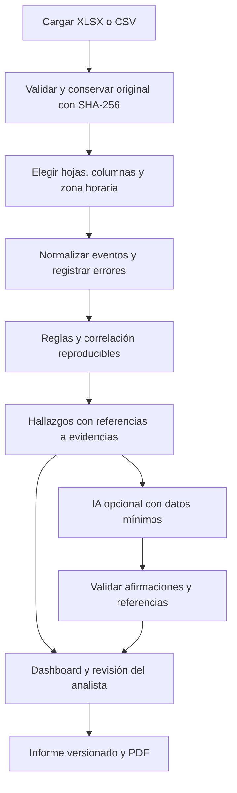

# Arquitectura propuesta

Estado: diseño para la primera versión. Los casos, diagnóstico local e importación están implementados; consultar LOCAL_SETUP.md, INGESTION.md y VERIFICATION.md para el alcance comprobado.

## Objetivo y límites

Una aplicación para investigar archivos SIEM de un cliente por caso, con evidencias trazables y revisión humana. Primera entrega para uso local; cualquier despliegue compartido requiere autenticación, aislamiento entre organizaciones y controles de acceso verificados. No ejecuta comandos ni contiene equipos, no integra un SIEM y no confirma incidentes automáticamente.

## Decisiones técnicas

| Área | Elección | Motivo |
| --- | --- | --- |
| Interfaz | Next.js, React y TypeScript | Navegación por casos, componentes reutilizables y contratos tipados |
| API y dominio | Python, FastAPI y Pydantic | Validación de entradas y contrato OpenAPI |
| Persistencia | PostgreSQL con SQLAlchemy y migraciones Alembic | Relaciones entre casos, eventos, hallazgos y evidencias |
| Procesamiento | Worker Celery y Redis como cola | Separar importación, análisis y PDF de las peticiones web |
| Archivos | Volumen privado local; adaptador de almacenamiento futuro | Originales y PDF fuera del directorio público |
| Importación | CSV estándar y openpyxl con defusedxml | Lectura controlada de archivos; sin ejecutar fórmulas |
| PDF | ReportLab con plantilla versionada | Documento reproducible generado desde datos validados |
| IA | Ollama local con Qwen3-8B; herramientas de agente pendientes | Sin proveedor cloud ni fallback externo; diagnóstico disponible sin inferencia |
| Entorno | Docker Compose | Servicios reproducibles para desarrollo local |

Fijar versiones soportadas y lockfiles al implementar; revisar avisos de seguridad antes de instalarlas. Redis no será la fuente de verdad. Las tareas serán idempotentes, con estado persistente, límites y reintentos acotados.

Implementación intermedia de fase 2: la instalación nativa usa cola local con estados persistentes y un lector en subproceso, sin Celery/Redis. Solo admite una instancia de API. Los motivos, límites y recuperación están documentados en INGESTION.md; el worker distribuido sigue siendo parte de la arquitectura objetivo.

## Flujo



## Componentes y estructura prevista

```text
apps/web/                  interfaz, filtros y visualización
apps/api/                  rutas, autorización y contratos
packages/security_core/    normalización, reglas, correlación y riesgo
packages/ai/               proveedores, herramientas y validadores
packages/reporting/        modelo del informe y renderizado PDF
tests/                     pruebas unitarias, integración y extremo a extremo
fixtures/synthetic/        datos sintéticos con resultados esperados
infra/                     Compose y configuración de servicios
docs/                      diseño, decisiones y guías
```

Las rutas HTTP delegan al dominio; las reglas no dependen del modelo de IA. El frontend consume tipos derivados de OpenAPI. Cada cambio de reglas, normalización o prompt tiene una versión registrada en el análisis.

## Evidencia y tiempo

Conservar archivo original, hash, hoja, número de fila y valores originales con acceso restringido. Nunca modificar el original para normalizarlo. Un evento normalizado apunta a una fila de origen y registra advertencias. Los duplicados se identifican sin borrar sus referencias.

Guardar timestamp original, timestamp UTC, zona/offset elegido y calidad del parseo. No asumir la zona por estar el cliente en Estocolmo. Permitir Europe/Stockholm y tratar fechas ambiguas por horario de verano como errores a resolver. Eventos sin fecha válida quedan visibles pero fuera de correlaciones temporales; declarar esa limitación en el informe.

## Seguridad y privacidad

- Validar extensión, firma y estructura; aceptar solo .xlsx y .csv en la primera versión. Rechazar macros, archivos cifrados y contenido incompatible.
- Límites iniciales configurables: 20 MiB comprimidos, 200 MiB descomprimidos XLSX, 100 000 filas totales, 200 columnas, 32 KiB por celda y 120 segundos de importación. Rechazar excesos explícitamente; nunca truncar en silencio. Validar estos límites mediante pruebas de carga.
- Controlar ZIP bombs, XML malicioso, enlaces externos y fórmulas. No resolver enlaces ni recalcular celdas; marcar fórmulas y valores cacheados como limitación.
- Usar nombres internos aleatorios y rutas controladas. Escapar todo contenido al mostrarlo o generar PDF. Evitar que logs de la aplicación contengan registros, secretos o prompts completos.
- Para uso compartido: identidad OIDC, roles administrador/analista/lector y autorización por organización y caso en cada consulta, descarga y tarea. Probar acceso cruzado. TLS, secretos fuera de Git y política de retención antes de producción.
- Acceso externo a IA solo tras configuración explícita del responsable del caso: proveedor, datos enviados y política de retención. Minimizar campos y seudonimizar identificadores manteniendo correspondencias locales.
- Purga configurable de archivos, eventos, informes y datos derivados, considerando respaldos. Auditoría de importaciones, análisis, revisiones, exportaciones y borrados, sin incluir contenido sensible.

## Agente y modelo de IA

El agente coordina herramientas de lectura con alcance al caso: consultar eventos filtrados, obtener agregados y recuperar evidencias. Sin shell, navegación arbitraria, llamadas de red libres ni herramientas de contención. Presupuestos configurables de tiempo, tokens, herramientas y costo; límite de eventos por consulta.

Los logs son contenido no confiable. Las instrucciones del sistema y los datos se separan; el agente no obedece texto dentro de celdas. Toda salida usa un esquema validado. Cada afirmación factual requiere IDs de evidencia existentes y comprobación de sus atributos; una referencia válida por sí sola no demuestra la afirmación. Rechazar afirmaciones no sustentadas y marcar propuestas de IA pendientes de revisión. Preservar el resultado determinista si el proveedor falla.

Guardar proveedor/modelo declarado, versión de prompt, parámetros, hashes de entradas, resultado validado y consumo, con retención restringida. Una ejecución de IA puede variar; el conjunto de evidencias y las reglas deben poder reproducirse.

Fine-tuning será una etapa posterior para tareas delimitadas, como clasificación o redacción consistente. Requiere consentimiento sobre datos, anonimización, etiquetas revisadas, separación de entrenamiento/validación/prueba por caso y tiempo, comparación con un modelo base y medición de afirmaciones sin soporte. No incorpora los logs de cada cliente como entrenamiento ni sustituye evidencia de un caso nuevo.

## Fuentes técnicas consultadas

- [Next.js App Router](https://nextjs.org/docs/app).
- [FastAPI: validación y OpenAPI](https://fastapi.tiangolo.com/features/).
- [openpyxl: aviso de seguridad XML](https://openpyxl.readthedocs.io/en/stable/index.html).
- [Celery: tareas e idempotencia](https://docs.celeryq.dev/en/latest/userguide/tasks.html).
